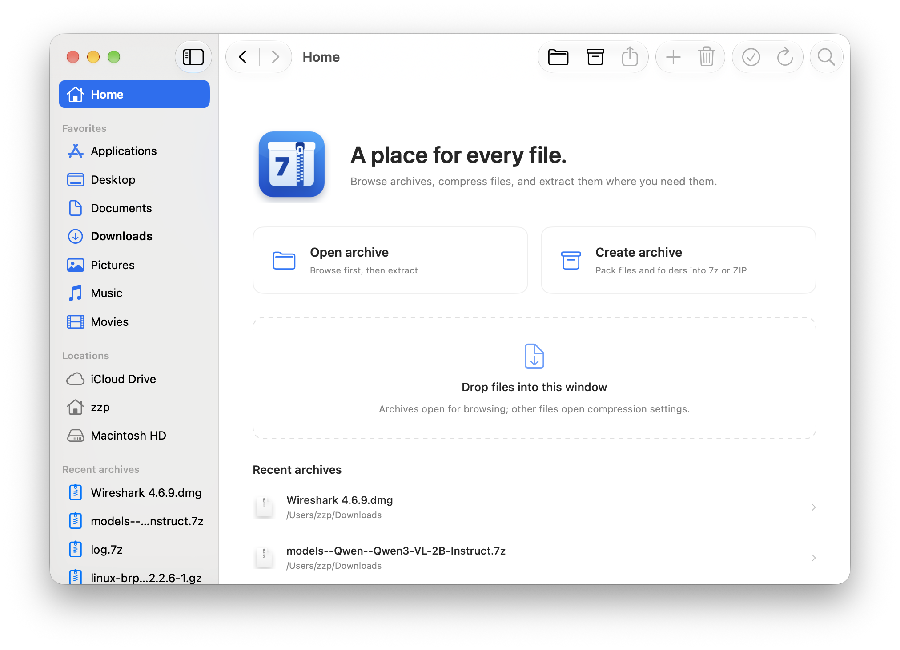

# SevenZip

## SevenZip — 7-Zip for macOS

A native macOS archive manager powered by the 7-Zip engine, built for Apple Silicon with SwiftUI and AppKit. SevenZip is an independent project, not an official 7-Zip GUI.

## Features

Browse archives, compress files and folders, extract selected items, and update existing ZIP and 7z archives.



### Formats supported

* **Create and update:** 7z and ZIP, including password-protected archives.
* **Browse and extract:** 7z, ZIP, RAR, TAR, GZip, BZip2, XZ, LZMA, Zstandard, CAB, ISO, DMG, WIM, ARJ, LZH, and split archives supported by the bundled 7-Zip engine.
* **Encryption:** AES-256 for new ZIP and 7z archives; encrypted 7z archives also protect filenames. ZIP passwords must use at most 99 printable ASCII characters; use 7z for Unicode passwords.

RAR is extraction-only. Compressed TAR archives such as `.tar.gz` / `.tgz`, `.tar.bz2` / `.tbz2`, and `.tar.xz` / `.txz` open directly to their TAR contents; browsing, extraction, and integrity checks include both layers. Ordinary single-file `.gz` archives keep their usual behavior. Double-clicking a supported archive inside another archive opens a private temporary copy in SevenZip.

### Highlights

* Native macOS controls and Liquid Glass on macOS 26/27, with support for macOS 13 and later.
* Apple Silicon **arm64** builds, with no Intel or Universal bundle.
* The 7-Zip engine is compiled from source into `libSevenZip.dylib` and called directly through a C interface. No `7zz` subprocess, Homebrew installation, or additional runtime is required to use the app.
* Finder-style sidebar, file icons, search, sortable columns, and back/forward navigation.
* Double-click an archive to browse its contents. Double-click a document inside it to extract a temporary copy and open it with its default application. Text scripts open in an editor.
* Add, replace, or delete entries in ZIP and 7z archives, with an original-archive backup saved before a successful update. Use **File → Show Backup** to locate it.
* Finder Services for compressing selected files and extracting archives, plus drag and drop.
* Progress, cancellation, password prompts, and archive integrity checks.
* English, Simplified Chinese, Traditional Chinese, Japanese, German, French, and Spanish, selected from system language preferences.

Changes saved to a temporary document are not automatically written back to its archive; add the edited file again to replace the original entry.

## Download and install

Download an **arm64 DMG** from [Releases](https://github.com/zhangzp9970/SevenZip/releases), open it, and drag **SevenZip.app** into **Applications**. Launch the application once to register its Finder Services.

Current builds use an ad-hoc signature and are **not notarized by Apple**. macOS may block their first launch. Developer ID signing and notarization are not configured in the release workflow.

Finder actions are available from the **Services** submenu. If they do not appear, enable them in **System Settings → Keyboard → Keyboard Shortcuts → Services**. SevenZip does not change default file associations automatically; choose it under **Get Info → Open with** when desired.

## Build

Requires an Apple Silicon Mac and Apple Command Line Tools or Xcode with a macOS 26 or newer SDK.

```bash
git clone --recurse-submodules https://github.com/zhangzp9970/SevenZip.git
cd SevenZip
./build.sh
./package-dmg.sh
```

For an existing checkout, run `git submodule update --init --recursive` first. The application is generated at `dist/SevenZip.app`, and the DMG is generated in `dist/`. Scripts resolve project paths relative to their own location; build products and caches stay in this checkout's `dist/` and `.build/` directories.

Run the checks after building:

```bash
./check.sh
./check-browser.sh
./check-sorting.sh
./check-localizations.sh
./check-archives.sh
```

## Automated releases

The [release workflow](.github/workflows/release.yml) runs on [GitHub’s macOS 26 arm64 runner](https://github.blog/changelog/2026-02-26-macos-26-is-now-generally-available-for-github-hosted-runners/). It builds the application, runs all five checks, and publishes a DMG, a complete source archive including 7-Zip, and SHA-256 checksums.

* **Push to `main` (the default branch):** publish a preview release tagged `v<version>-build.<run_number>.<run_attempt>`.
* **Push a `v<version>` tag:** publish a stable release. The tag version must match `CFBundleShortVersionString` in `Resources/Info.plist`.
* **Pull request:** build and check the change, and upload artifacts without publishing a release.
* **Manual run:** choose the default branch to publish a preview release; other branches build artifacts only.

Update `CFBundleShortVersionString` and `CFBundleVersion` in `Resources/Info.plist` when preparing a new application version. The workflow uses GitHub's built-in `GITHUB_TOKEN`; no personal access token is needed. Releases are published only after every build, check, and packaging step succeeds. An existing published version is never overwritten.

To publish a stable version after pushing the corresponding code, for example:

```bash
git tag v0.2.3
git push origin v0.2.3
```

Use the version currently recorded in `Resources/Info.plist`. Preview builds appear under **Releases** with the **Pre-release** label.

## Third party libraries

[7-Zip](https://www.7-zip.org/) — archive formats and compression codecs, maintained by Igor Pavlov and contributors. The source is included through the `vendor/7zip` Git submodule.

7-Zip retains its own licensing terms and notices. See [License.txt](https://github.com/ip7z/7zip/blob/4d083af5c462bc6f0f10c0c850834d60845d12e3/DOC/License.txt), [copying.txt](https://github.com/ip7z/7zip/blob/4d083af5c462bc6f0f10c0c850834d60845d12e3/DOC/copying.txt), and [unRarLicense.txt](https://github.com/ip7z/7zip/blob/4d083af5c462bc6f0f10c0c850834d60845d12e3/DOC/unRarLicense.txt). These notices are also included in the application bundle.

The full GPLv3 text for SevenZip is provided in [LICENSE](LICENSE) and bundled with the application.

## Acknowledgements

Created by Zeping Zhang with assistance from ChatGPT.

Thanks to Igor Pavlov and the 7-Zip contributors for the archive engine, and to everyone who tests SevenZip and shares feedback.

## Licence

Copyright © 2026 Zeping Zhang

This program is free software: you can redistribute it and/or modify
it under the terms of the GNU General Public License as published by
the Free Software Foundation, either version 3 of the License, or
(at your option) any later version.

This program is distributed in the hope that it will be useful,
but WITHOUT ANY WARRANTY; without even the implied warranty of
MERCHANTABILITY or FITNESS FOR A PARTICULAR PURPOSE.  See the
GNU General Public License for more details.

You should have received a copy of the GNU General Public License
along with this program.  If not, see [http://www.gnu.org/licenses/](http://www.gnu.org/licenses/).
